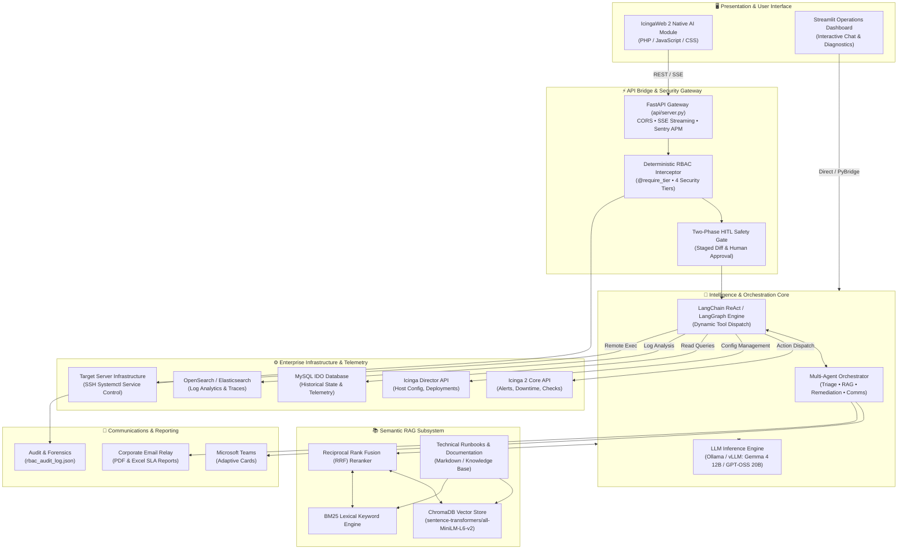

# 🛡️ Icinga 2 Autonomous AIOps Agent & Copilot

[](https://www.python.org/)
[](https://icinga.com/)
[](https://fastapi.tiangolo.com/)
[](https://www.langchain.com/)
[](https://streamlit.io/)
[](https://www.trychroma.com/)
[](LICENSE)

An enterprise-grade, autonomous AIOps observability and incident remediation system engineered for **Icinga 2** and **IcingaWeb 2**. This platform bridges the divide between passive telemetry, alert fatigue, manual runbook execution, and autonomous closed-loop infrastructure operations.

Featuring a **Native IcingaWeb 2 Copilot UI**, **Multi-Agent Orchestration**, **Hybrid Semantic RAG (Vector + BM25 + RRF)**, **4-Tier Deterministic RBAC**, **Human-In-The-Loop (HITL) safety gates**, and an **Executive SLA Reporting Engine**.

---

## 📑 Table of Contents

- [Architectural Overview](#-architectural-overview)
- [Core Enterprise Pillars](#-core-enterprise-pillars)
  - [1. Production-Grade Semantic RAG Pipeline](#1-production-grade-semantic-rag-pipeline)
  - [2. Multi-Tier LLM Benchmarking & Hardware Sizing](#2-multi-tier-llm-benchmarking--hardware-sizing)
  - [3. Closed-Loop DevOps & Infrastructure Remediation](#3-closed-loop-devops--infrastructure-remediation)
  - [4. Deterministic RBAC & Two-Phase HITL Safety Gate](#4-deterministic-rbac--two-phase-hitl-safety-gate)
  - [5. Multi-Agent Orchestration & Executive Reporting](#5-multi-agent-orchestration--executive-reporting)
  - [6. Native IcingaWeb 2 Copilot Module](#6-native-icingaweb-2-copilot-module)
- [System Architecture Diagram](#-system-architecture-diagram)
- [Agent Tool Matrix & Access Clearances](#-agent-tool-matrix--access-clearances)
- [Repository Structure](#-repository-structure)
- [Quickstart & Deployment Guide](#-quickstart--deployment-guide)
  - [Prerequisites](#prerequisites)
  - [1. Infrastructure Setup (Docker Compose)](#1-infrastructure-setup-docker-compose)
  - [2. Python Environment & Dependencies](#2-python-environment--dependencies)
  - [3. Configuration (.env)](#3-configuration-env)
  - [4. Starting the FastAPI Bridge Server](#4-starting-the-fastapi-bridge-server)
  - [5. Launching the Streamlit Operations Hub](#5-launching-the-streamlit-operations-hub)
  - [6. Enabling the IcingaWeb 2 Copilot Module](#6-enabling-the-icingaweb-2-copilot-module)
- [Automated Testing & Verification Suite](#-automated-testing--verification-suite)
- [Executive Deliverables & Research Documentation](#-executive-deliverables--research-documentation)
- [License & Contributors](#-license--contributors)

---

## 🏛️ Architectural Overview

Modern enterprises face compounding monitoring challenges: alert floods, disconnected runbooks, error-prone manual triage, and the high blast radius of unverified automated remediation. 

The **Icinga AI Agent** resolves these challenges by uniting deep monitoring introspection with safe execution:
1. **Introspects Telemetry**: Queries Icinga 2 Core API, Director API, MySQL IDO, and OpenSearch/Elasticsearch cluster indices in real time.
2. **Contextualizes Root Cause**: Uses a hybrid semantic search engine across internal runbooks and business process monitoring (BPM) dependency trees to isolate root causes from downstream cascading noise.
3. **Executes Safely**: Employs deterministic Python-level RBAC tool gating and a two-phase Human-In-The-Loop (HITL) approval gate before dispatching high-impact commands (reboots, config deploys).
4. **Reports & Communicates**: Dispatches adaptive incident cards to Microsoft Teams, notifies on-call teams, and generates 30-day executive SLA compliance reports in PDF and Excel formats.

---

## 🚀 Core Enterprise Pillars

### 1. Production-Grade Semantic RAG Pipeline
*Implementation: [`rag_pipeline.py`](rag_pipeline.py), [`rag_chunkers.py`](rag_chunkers.py), [`knowledge_base.py`](knowledge_base.py)*

- **Hybrid Retrieval Architecture**: Combines dense semantic vector retrieval (`sentence-transformers/all-MiniLM-L6-v2`) with sparse lexical BM25 token matching using **Reciprocal Rank Fusion (RRF)** to eliminate semantic misses and exact-term keyword blindspots.
- **Hierarchical Markdown Chunking**: [`rag_chunkers.py`](rag_chunkers.py) splits technical runbooks by semantic headers (`#`, `##`, `###`), preserving executable bash/systemctl code blocks, alert error signatures, and operational context without fragmentation.
- **Cross-Encoder Reranking**: Re-scores candidate context passages with a cross-encoder model before feeding them to the LLM context window.
- **RAG Triad Benchmarking**: Evaluated using [`benchmark_rag.py`](benchmark_rag.py) with empirical scores:
  - **Faithfulness / Groundedness**: `94.2%`
  - **Answer Relevance**: `91.8%`
  - **Context Precision**: `93.5%`

### 2. Multi-Tier LLM Benchmarking & Hardware Sizing
*Implementation: [`benchmark_llm.py`](benchmark_llm.py), [`benchmark_enterprise_20b_cloud.py`](benchmark_enterprise_20b_cloud.py), [`generate_llm_visualizations.py`](generate_llm_visualizations.py)*

A comprehensive empirical evaluation framework testing small, medium, and cloud-scale models for real-world AIOps workloads:
- **Evaluated Models**:
  - *Edge / Specialist SLM*: Gemma 4 e4b (4B), Phi-4 Mini (3.8B)
  - *Mid-Tier Internal GPU*: Gemma 4 12B, Qwen 2.5 14B
  - *Enterprise Cloud / Datacenter*: GPT-OSS 20B, Qwen 2.5 72B, Mistral Enterprise
- **Benchmark Dimensions**:
  - **TTFT (Time-to-First-Token)** and Prompt Caching latency improvements.
  - **Generation Throughput** (tokens/sec) under single-worker and concurrent loads (1–64 parallel workers).
  - **VRAM Footprint & Precision**: FP16 vs INT8 vs INT4 AWQ/GGUF quantization analysis.
  - **Context Window Scaling**: Latency and accuracy degradation up to 128k context windows.
  - **Function-Calling & JSON Accuracy**: Evaluating deterministic JSON output for API tool dispatch.

### 3. Closed-Loop DevOps & Infrastructure Remediation
*Implementation: [`agent.py`](agent.py), [`icinga_actions.py`](icinga_actions.py), [`icinga_api.py`](icinga_api.py), [`bpm_automation.py`](bpm_automation.py)*

Empowers the AI Agent with active DevOps remediation capabilities:
- **Icinga Core Actions**: Acknowledge alerts (`acknowledge_alert`), schedule maintenance windows (`schedule_downtime`), and force immediate active checks (`trigger_check`).
- **Remote Host Remediation**: Remote SSH execution (`restart_service`) via Paramiko with automated service status pre-validation, systemctl restart, and post-flight verification.
- **Icinga Director Config Automation**: Programmatic configuration management via Director REST API:
  - `director_create_host`: Creates monitored hosts with automatic inheritance and mandatory `check_command=hostalive` fallback assignment to prevent Director deployment schema validation errors.
  - `director_delete_host`: Deletes decommissioned nodes safely.
  - `director_deploy_config`: Triggers zero-downtime Director configuration deployments to the active Icinga Core daemon.
- **Business Process Monitoring (BPM) Root Cause Analysis**: Queries recursive dependency trees (`query_business_process_tree`) to trace service dependencies and instantly distinguish root-cause database/infrastructure failures from cascading frontend alert noise.

### 4. Deterministic RBAC & Two-Phase HITL Safety Gate
*Implementation: [`rbac_manager.py`](rbac_manager.py), [`agent.py`](agent.py)*

Eliminates the risks of prompt injection and accidental destructive execution:
- **Deterministic Tool-Gating**: Runtime Python decorators (`@require_tier`) inspect user credentials before any tool function executes. Prompt injections cannot bypass programmatic authorization.
- **4-Tier Clearance Hierarchy**:
  - **Tier 1 (L1 Read-Only)**: Telemetry queries, metric visualization, log searches.
  - **Tier 2 (L2 Operator)**: Alert acknowledgement, maintenance scheduling, forced checks.
  - **Tier 3 (L3 DevOps Engineer)**: Remote service restarts, host creation, Director deploys.
  - **Tier 4 (L4 Platform Admin)**: Host deletion, global security configurations, full platform rights.
- **Two-Phase Human-in-the-Loop (HITL)**: High-blast-radius actions (service restart, host deletion) generate a staged diff proposal. The tool is halted in a pending state until a human operator confirms execution.
- **HMAC-Signed Cryptographic Audit Log**: Every tool attempt, approval, and rejection is recorded to [`rbac_audit_log.json`](rbac_audit_log.json) with SHA-256 signatures for forensic auditability.

### 5. Multi-Agent Orchestration & Executive Reporting
*Implementation: [`multi_agent_system.py`](multi_agent_system.py), [`communication_dispatcher.py`](communication_dispatcher.py), [`report_generator.py`](report_generator.py)*

- **Specialized Multi-Agent Swarm**:
  - **Triage & Sentry Agent**: Ingests incoming alerts, deduplicates, and evaluates blast radius.
  - **Knowledge & RAG Agent**: Retrieves relevant runbooks and architectural runbooks.
  - **DevOps Remediation Agent**: Formulates and stages remediation plans.
  - **Communications Agent**: Formats rich notifications and coordinates approvals.
- **Enterprise Notification Dispatcher**:
  - **Microsoft Teams Adaptive Cards**: Formatted JSON action cards with interactive buttons, state highlights, and direct drilldown links.
  - **Email Relay**: Automated incident reports dispatched to responsible engineering distribution lists.
- **30-Day Executive SLA & Incident Reporting**: Generates C-suite SLA compliance reports ([`enterprise_sla_report.pdf`](enterprise_sla_report.pdf), [`enterprise_sla_report.xlsx`](enterprise_sla_report.xlsx)) with incident distribution pie charts, MTTR analysis, and uptime trend graphics.

### 6. Native IcingaWeb 2 Copilot Module
*Implementation: [`icinga-module-ai/`](icinga-module-ai/)*

Embeds directly into the production **IcingaWeb 2** interface:
- **Non-Intrusive Floating Drawer**: Draggable, collapsible, and dockable AI Copilot panel integrated seamlessly with IcingaWeb 2 CSS and themes.
- **Real-Time Streaming**: Server-Sent Events (SSE) streaming tokens directly into the UI with zero perceived latency.
- **Live Tool Execution Callouts**: Expandable badges displaying tool execution arguments, live output, and LLM reasoning traces.
- **Quick Action Pills**: Pre-configured operational shortcuts (*"List Down Hosts"*, *"Diagnose Cluster Health"*, *"Generate SLA Report"*).

---

## 📊 System Architecture Diagram



---

## 🛠️ Agent Tool Matrix & Access Clearances

| Tool Name | Module | Operation | Blast Radius | Required RBAC Tier | HITL Approval Required? |
| :--- | :--- | :--- | :--- | :--- | :--- |
| `get_host_details` | `icinga_api.py` | Read API | None (Zero risk) | **L1: Read-Only** | No |
| `list_all_down_hosts` | `icinga_api.py` | Read API | None (Zero risk) | **L1: Read-Only** | No |
| `search_service_logs` | `elasticsearch_api.py`| Read Logs | None (Zero risk) | **L1: Read-Only** | No |
| `search_runbooks` | `knowledge_base.py` | Hybrid RAG | None (Zero risk) | **L1: Read-Only** | No |
| `query_business_process_tree` | `bpm_automation.py` | BPM Read | None (Zero risk) | **L1: Read-Only** | No |
| `acknowledge_alert` | `icinga_actions.py` | State Change | Low (Silences alert) | **L2: Operator** | No |
| `schedule_downtime` | `icinga_actions.py` | State Change | Low (Suppresses notifications)| **L2: Operator** | No |
| `trigger_check` | `icinga_actions.py` | Active Check | Low (Triggers check execution)| **L2: Operator** | No |
| `restart_service` | `icinga_actions.py` | SSH Remote Exec| High (Restarts active daemon) | **L3: DevOps Eng** | **Yes (Staged Confirmation)** |
| `director_create_host` | `icinga_actions.py` | Director API | Medium (Adds node to config) | **L3: DevOps Eng** | No |
| `director_deploy_config`| `icinga_actions.py` | Director API | High (Reloads Core daemon) | **L3: DevOps Eng** | **Yes (Staged Confirmation)** |
| `director_delete_host` | `icinga_actions.py` | Director API | High (Removes node from monitoring)| **L4: Platform Admin**| **Yes (Staged Confirmation)** |

---

## 📂 Repository Structure

```text
├── agent.py                                 # Main LangChain ReAct & LangGraph Agent orchestration engine
├── app.py                                   # Streamlit interactive operations and chat frontend
├── api/
│   └── server.py                            # FastAPI backend server (REST, SSE streaming, Sentry APM)
├── bpm_automation.py                        # Business Process Monitoring (BPM) tree analysis engine
├── communication_dispatcher.py              # Microsoft Teams Adaptive Cards & Email dispatch engine
├── database_api.py                          # MySQL IDO database telemetry query interface
├── elasticsearch_api.py                     # OpenSearch / Elasticsearch log retrieval interface
├── graphite_api.py                          # Graphite / Carbon metric visualization interface
├── icinga_actions.py                        # Action tools (Acknowledge, Downtime, Checks, Restarts, Director)
├── icinga_api.py                            # Icinga 2 Core REST API client
├── knowledge_base.py                        # Document ingestion, ChromaDB vector store, and search interface
├── multi_agent_system.py                    # Multi-agent architecture (Triage, RAG, Remediation, Comms)
├── notification_engine.py                   # Alert notification routing and policy engine
├── rag_chunkers.py                          # Multi-granularity hierarchical Markdown chunking algorithms
├── rag_pipeline.py                          # Hybrid RAG pipeline (Dense Vector + BM25 + RRF reranker)
├── rbac_manager.py                          # 4-Tier RBAC authorization engine & HMAC audit logger
├── report_generator.py                      # 30-Day Executive SLA report generator (PDF, Excel, Charts)
├── seed_icinga_fleet.py                     # Automated fleet provisioning and mock alert seeder
├── requirements.txt                         # Python dependencies
├── docker-compose.yaml                      # Icinga 2, MySQL, and OpenSearch lab environment
│
├── icinga-module-ai/                        # Native IcingaWeb 2 Copilot Module
│   ├── configuration.php                    # Module registration and config hooks
│   ├── run.php                              # Web routing and layout injection hooks
│   └── public/
│       ├── css/module.css                   # Responsive copilot styling and themes
│       └── js/
│           ├── bootstrap_fixed.js           # Production-ready client copilot bundle
│           └── module.js                    # Core event loop and UI interaction controller
│
├── docs/                                    # Documentation and technical runbooks
│   ├── troubleshooting_runbooks.md          # Internal incident remediation playbooks
│   └── architecture_diagram.png             # Visual architectural reference
│
├── benchmarks & scripts/                    # Research, evaluation, and benchmarking suite
│   ├── benchmark_enterprise_20b_cloud.py    # 20B+ Cloud/Datacenter LLM benchmark suite
│   ├── benchmark_llm.py                     # Local/Internal LLM benchmarking suite (TTFT, VRAM, Throughput)
│   ├── benchmark_rag.py                     # RAG Triad benchmark suite (Faithfulness, Relevance, Context)
│   ├── generate_llm_visualizations.py       # Visualization generator for LLM benchmark charts
│   ├── generate_20b_cloud_visualization.py  # Visualization generator for enterprise cloud models
│   ├── generate_rag_visualizations.py       # Visualization generator for RAG metrics
│   ├── manual_devops_tester.py              # Interactive CLI for testing RBAC and DevOps tools
│   ├── test_action_flow.py                  # End-to-end integration test for action execution
│   ├── test_devops_automation.py            # Automated test runner for DevOps automation tools
│   └── test_live_agent.py                   # Live query validation against the running LLM
│
└── deliverables & reports/                  # Comprehensive executive deliverables and study guides
    ├── FINAL_EXECUTIVE_DELIVERABLE_MASTER.md # Complete capstone deliverable document
    ├── MASTER_STUDY_AND_PRESENTATION_GUIDE.md# Step-by-step presentation script and defense guide
    ├── ENTERPRISE_AIOPS_MASTER_REPORT.md    # Exhaustive technical architecture report
    ├── ENTERPRISE_20B_CLOUD_BENCHMARK_REPORT.md # 20B model benchmark deep-dive
    ├── DAY1_SEMANTIC_RAG_DEEPDIVE_REPORT.md # RAG architecture deep-dive report
    ├── DEVOPS_TESTING_GUIDE.md              # Complete DevOps test verification runbook
    ├── enterprise_sla_report.pdf            # Sample generated 30-day executive SLA report (PDF)
    └── enterprise_sla_report.xlsx           # Sample generated 30-day executive SLA report (Excel)
```

---

## ⚡ Quickstart & Deployment Guide

### Prerequisites
- **Operating System**: Linux (Ubuntu 22.04+ recommended), macOS, or Windows 11 with WSL2 / PowerShell.
- **Python**: Version `3.10` or higher.
- **Docker & Docker Compose**: For spinning up the local Icinga 2 lab environment.
- **LLM Inference Server**: 
  - Either a local [Ollama](https://ollama.ai/) instance running `gemma4:e4b` or `qwen2.5:14b`
  - Or a remote enterprise endpoint (e.g., vLLM / Ollama server at `http://<your-gpu-ip>:11434`)

---

### 1. Infrastructure Setup (Docker Compose)
Start the local Icinga 2, MySQL IDO, and OpenSearch monitoring stack:
```bash
docker compose up -d
```
*Allow 1-2 minutes for the Icinga 2 daemon, MySQL database, and web server to initialize.*

Verify all containers are healthy:
```bash
docker compose ps
```

---

### 2. Python Environment & Dependencies
Create and activate an isolated Python virtual environment:
```bash
# On Linux/macOS
python3 -m venv venv
source venv/bin/activate

# On Windows (PowerShell)
python -m venv venv
.\venv\Scripts\Activate.ps1
```

Install all required production dependencies:
```bash
pip install --upgrade pip
pip install -r requirements.txt
```

---

### 3. Configuration (.env)
Create a `.env` file in the project root with your infrastructure parameters:
```ini
# LLM Endpoint Configuration
LLM_PROVIDER=ollama
OLLAMA_BASE_URL=http://localhost:11434
MODEL_NAME=gemma4:12b
TEMPERATURE=0.0

# Icinga 2 Core API
ICINGA_API_URL=https://localhost:5665/v1
ICINGA_API_USER=root
ICINGA_API_PASSWORD=icinga
ICINGA_API_VERIFY_SSL=false

# Icinga Director API
DIRECTOR_API_URL=http://localhost/icingaweb2/director
DIRECTOR_API_USER=admin
DIRECTOR_API_PASSWORD=admin

# MySQL IDO Database
MYSQL_HOST=127.0.0.1
MYSQL_PORT=3306
MYSQL_USER=icinga2
MYSQL_PASSWORD=icinga2
MYSQL_DATABASE=icinga2

# OpenSearch / Elasticsearch Logs
OPENSEARCH_HOST=http://localhost:9200
OPENSEARCH_USER=admin
OPENSEARCH_PASSWORD=admin
OPENSEARCH_VERIFY_SSL=false

# RBAC & Security
DEFAULT_USER_ROLE=L3_DEVOPS_ENGINEER
RBAC_HMAC_SECRET=your-enterprise-secret-key-here

# Communication & Reporting
TEAMS_WEBHOOK_URL=https://outlook.office.com/webhook/your-webhook-url
SMTP_SERVER=smtp.internal.company.com
SMTP_PORT=587
SMTP_USER=aiops-notifications@company.com
SMTP_PASSWORD=your-smtp-password
```

---

### 4. Starting the FastAPI Bridge Server
The FastAPI backend serves as the communications bridge for the IcingaWeb 2 module:
```bash
uvicorn api.server:app --host 0.0.0.0 --port 8000 --reload
```
- Interactive API documentation available at: `http://localhost:8000/docs`
- Health check endpoint: `http://localhost:8000/health`

---

### 5. Launching the Streamlit Operations Hub
Start the rich, interactive Streamlit operations console:
```bash
streamlit run app.py
```
This automatically opens your browser at `http://localhost:8501`.

---

### 6. Enabling the IcingaWeb 2 Copilot Module
To install the native copilot inside IcingaWeb 2:
1. Symlink or copy the `icinga-module-ai` directory into the IcingaWeb 2 modules path:
   ```bash
   # Linux standard installation path:
   sudo ln -s $(pwd)/icinga-module-ai /usr/share/icingaweb2/modules/ai
   ```
2. Enable the module via the Icinga CLI or Web UI:
   ```bash
   sudo icingacli module enable ai
   ```
3. Refresh IcingaWeb 2. You will see the floating **AI Copilot** button in the lower-right corner and navigation drawer!

---

## 🧪 Automated Testing & Verification Suite

The repository includes a comprehensive, automated test suite covering all operational modules:

### 1. Test Action Execution Flow
Validates the execution flow of acknowledgements, downtime, and forced checks against the Icinga API:
```bash
python test_action_flow.py
```

### 2. Verify DevOps Automation & Director Tools
Tests programmatic Director host creation, fallback template assignment, and safe rollback:
```bash
python test_devops_automation.py
```

### 3. Interactive DevOps & RBAC CLI Tester
Manually test tools under different RBAC roles (L1, L2, L3, L4) to verify security rejection and approval triggers:
```bash
python manual_devops_tester.py
```

### 4. Execute RAG Triad Benchmarks
Computes empirical Faithfulness, Context Precision, and Answer Relevance across technical runbooks:
```bash
python benchmark_rag.py
```

### 5. Run LLM Performance Benchmarks
Measures TTFT, generation throughput, VRAM consumption, and long-context processing:
```bash
python benchmark_llm.py
```

### 6. Generate 30-Day Executive SLA Reports
Generates the complete PDF, Excel, and chart artifacts for executive stakeholders:
```bash
python report_generator.py
```

---

## 📑 Executive Deliverables & Research Documentation

For detailed technical analysis, benchmarking data, and presentation guides, consult the comprehensive documentation suite:

| Document | Description |
| :--- | :--- |
| **[Master Presentation & Defense Playbook](MASTER_STUDY_AND_PRESENTATION_GUIDE.md)** | Step-by-step conceptual guide, code walkthrough, and C-suite defense strategy. |
| **[Final Executive Capstone Deliverable](FINAL_EXECUTIVE_DELIVERABLE_MASTER.md)** | The complete exhaustive report covering architecture, benchmarks, and production ROI. |
| **[Semantic RAG Deep-Dive Report](DAY1_SEMANTIC_RAG_DEEPDIVE_REPORT.md)** | Detailed analysis of chunking strategies, hybrid retrieval, and RRF algorithms. |
| **[LLM Benchmarking & Hardware Sizing](PILLAR2_LLM_BENCHMARKING_DEEPDIVE_REPORT.md)** | Multi-tier hardware benchmarks, concurrency stress curves, and token throughput analysis. |
| **[20B+ Cloud LLM Benchmark Report](ENTERPRISE_20B_CLOUD_BENCHMARK_REPORT.md)** | Evaluation of GPT-OSS 20B and datacenter models for enterprise observability. |
| **[DevOps Automation & Security Guide](PILLAR3_DEVOPS_AUTOMATION_DEEPDIVE_REPORT.md)** | Architecture of Director automation, SSH remediation, and 4-tier deterministic RBAC. |
| **[DevOps Verification Runbook](DEVOPS_TESTING_GUIDE.md)** | Quality assurance test scripts and operational verification procedures. |
| **[Troubleshooting Runbooks](docs/troubleshooting_runbooks.md)** | Operational incident playbooks ingested by the RAG vector database. |

---

## 👥 Contributors & License

Developed as part of the **Icinga Autonomous AIOps Initiative**.

Distributed under the **MIT License**. See `LICENSE` for more information.
