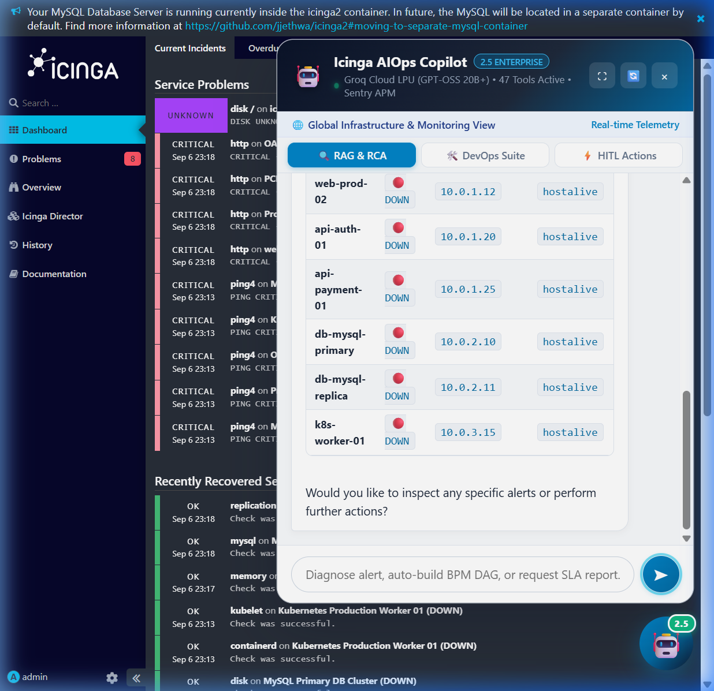
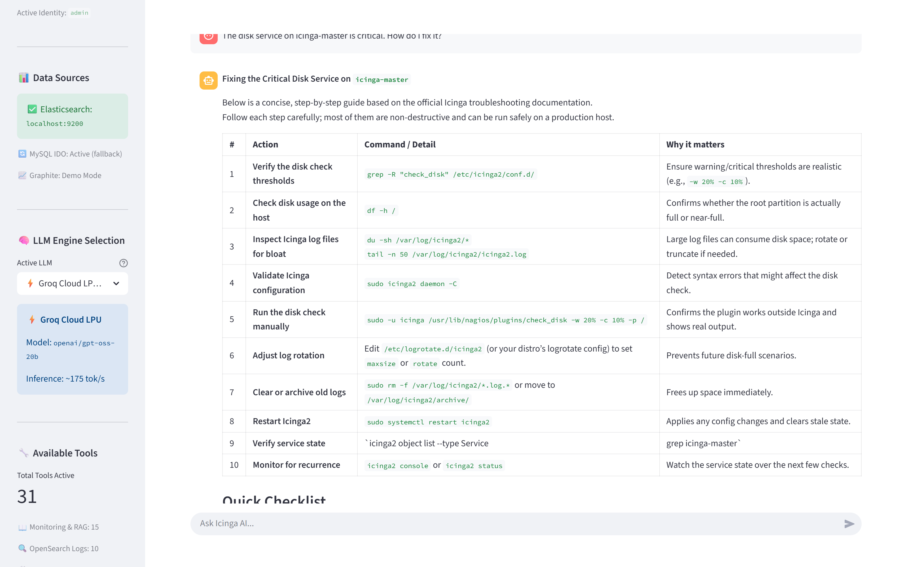
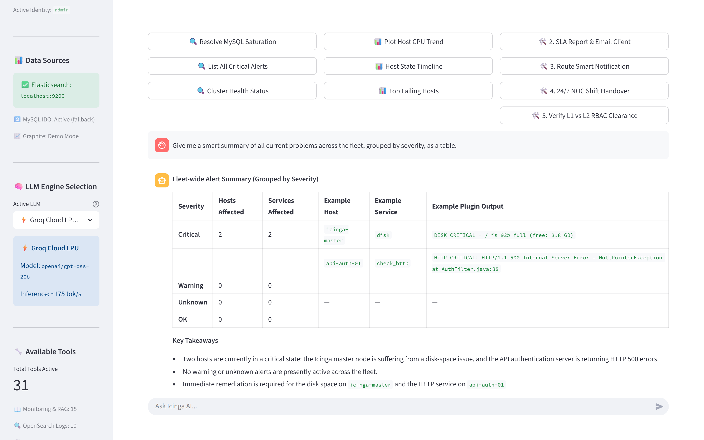
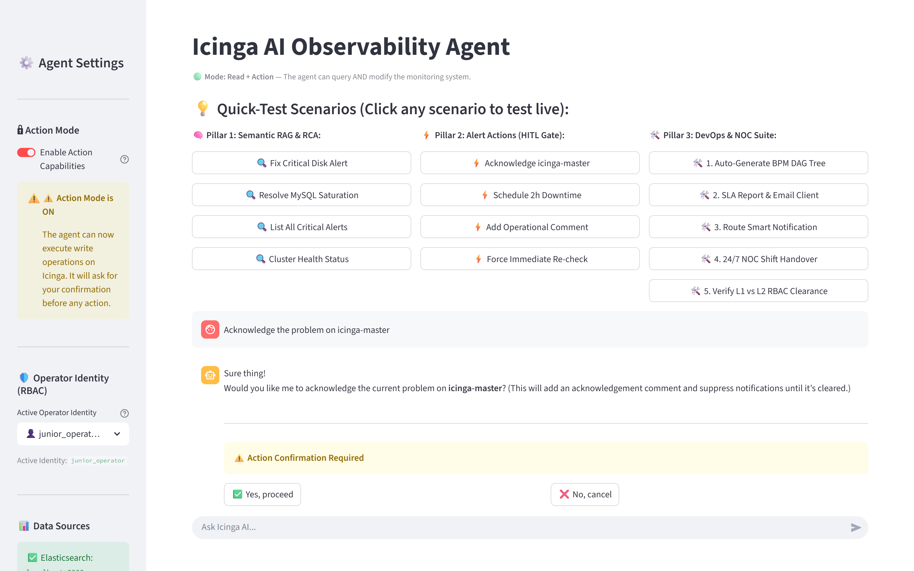
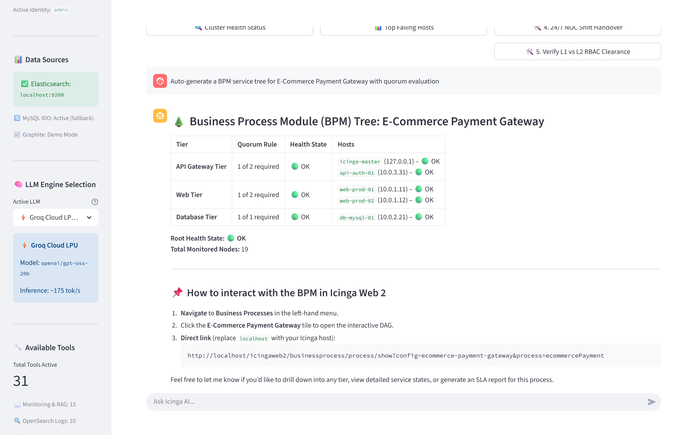
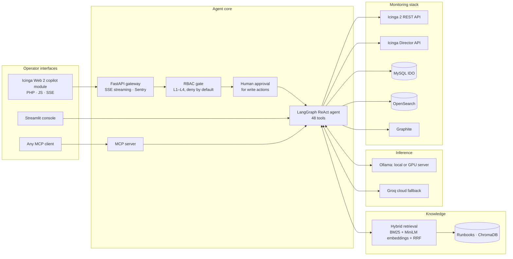

# Icinga AIOps Agent

An AI operations copilot for **Icinga 2**. Ask questions in plain English, and it queries live monitoring data, grounds its root-cause analysis in your runbooks, and can take real actions on the monitoring stack (acknowledge alerts, schedule downtime, onboard hosts through Icinga Director). Every action passes a deterministic role-based access check and a human approval step first.


<p align="center">
  
  <br><em>The copilot runs inside Icinga Web 2 as a native module, streaming answers next to the monitoring views.</em>
</p>

---

## Background

I built this solo during my AI engineering internship at **IOTA Solutions**. It started as a six-week project and was extended by four weeks into a product-development challenge for their monitoring platform, **Trace9**. It went through three MVPs in ten weeks, and the agent now runs as a module in their environment.

| Phase | Focus | Highlights |
| :--- | :--- | :--- |
| **MVP 1** — Read-only observability agent | Natural-language interface over the Icinga 2 API | LangChain ReAct agent on a local Ollama model, Streamlit console, RAG over troubleshooting runbooks, alert grouping and correlation |
| **MVP 2** — Action-capable agent | Let the agent change things, safely | Acknowledgements, downtimes, comments, forced re-checks, host/service onboarding through the Icinga Director API, OpenSearch log analytics, Graphite metric plots, human-in-the-loop confirmations |
| **MVP 3** — Enterprise upgrade | Production hardening and evaluation | LangGraph state machine, MCP server, hybrid BM25 + dense retrieval, 4-tier RBAC with an audit log, native Icinga Web 2 copilot module, FastAPI SSE backend, Sentry tracing, LLM benchmarking on a dedicated 16 GB GPU, SLA reporting and NOC automation |

Phase-by-phase write-ups live in [`docs/phases/`](docs/phases).

---

## What it can do

<table>
<tr>
<td width="50%"><br><b>Root-cause analysis grounded in runbooks.</b> Hybrid retrieval pulls the relevant remediation steps instead of letting the model guess.</td>
<td width="50%"><br><b>Fleet-wide triage.</b> Live host and service state, grouped and summarized on request.</td>
</tr>
<tr>
<td width="50%"><br><b>Human-in-the-loop gate.</b> Write actions stop for explicit operator approval, and they are checked against the operator's RBAC tier before they run.</td>
<td width="50%"><br><b>Business-process automation.</b> Generates quorum-based business-process trees for Icinga's Business Process module.</td>
</tr>
</table>

**48 agent tools** across five areas:

- **Monitoring reads**: system status, hosts, services, critical alerts, outage history, downtimes, notification history, check statistics, state timelines.
- **Logs and metrics**: OpenSearch/Elasticsearch search, error aggregation, log-spike detection, cluster health, and Graphite metric plots.
- **Actions**: acknowledge or un-acknowledge, schedule downtime, add comments, send custom notifications, force re-checks.
- **Icinga Director automation**: create host groups, templates, hosts, service groups, services, service sets and check commands, then deploy the config.
- **NOC automation**: business-process tree synthesis, 30-day SLA reports (PDF and Excel), smart alert routing, shift-handover briefings to email and Microsoft Teams.

---

## Architecture



### Design decisions

- **Authorization lives in code, not in the prompt.** The `@require_tier` decorator and `RBACManager` check the operator's tier at the tool's Python entry point, before any side effect, so a prompt injection cannot talk the model past the check. Any tool missing from the permission map requires the top tier (deny by default), and every authorized or blocked attempt is written to an audit log.
- **Two locks on every write.** An action needs both the right RBAC tier and explicit operator confirmation in the UI.
- **Hybrid retrieval.** Pure vector search missed exact tokens such as error codes and service names, so BM25 runs alongside dense embeddings and Reciprocal Rank Fusion merges the two ranked lists (k = 60). Runbooks are chunked on their Markdown headers so command blocks stay intact.
- **Tools exposed over MCP.** `mcp_server.py` serves the same tool registry through the Model Context Protocol, so any MCP-compatible client can use it, not just this UI.
- **Retrieval was benchmarked, not assumed.** Naive vector RAG, hybrid RAG, and an optimized pipeline (multi-query, HyDE, cross-encoder reranking, confidence threshold) were scored on the same 55-query set, distractors included. See the results below.
- **The model choice was measured.** 14 model configurations on a 4 GB laptop GPU and a 16 GB GPU server were benchmarked on throughput, time-to-first-token, KV-cache reuse and tool-call accuracy before choosing defaults.

---

## Measured results

**Retrieval quality.** 55 queries × 3 pipelines, including distractor queries ([raw results](benchmarks/results/rag_benchmark_results.json)):

| Pipeline | Precision@1 | Recall@3 | MRR | Hallucinated answers |
| :--- | :---: | :---: | :---: | :---: |
| Naive semantic RAG | 83.6% | 90.9% | 0.87 | 5 |
| Hybrid RAG (BM25 + dense + RRF) | 89.1% | 90.9% | 0.90 | 5 |
| **Optimized RAG** (domain-aware chunking + multi-query + HyDE + cross-encoder rerank + confidence threshold) | **98.2%** | **98.2%** | **0.98** | **0** |

The optimized pipeline also rejected 100% of the distractor queries, where the other two pipelines rejected none.

**LLM inference on the dedicated 16 GB GPU** ([raw results](benchmarks/results)):

| Model | Generation throughput | Tool-call precision |
| :--- | :---: | :---: |
| gpt-oss:20b (MXFP4) | ~120 tok/s | 100% ([report](docs/benchmarks/gpt-oss-20b.md)) |
| gemma4:e4b | ~95 tok/s | 100% |
| qwen3:14b (Q4_K_M) | ~80 tok/s | 60% |

---

## Quickstart

### Option A: try it in two minutes (no Docker)

`DEMO_MODE=true` makes the agent fall back to a built-in demo fleet whenever Icinga is unreachable.

```bash
git clone https://github.com/muneeb-zia/Icinga_AI_Agent.git
cd Icinga_AI_Agent
python -m venv .venv && source .venv/bin/activate   # Windows: .venv\Scripts\activate
pip install -r requirements.txt
cp .env.example .env
ollama pull llama3.1:8b        # or set LLM_PROVIDER=groq and GROQ_API_KEY in .env
streamlit run app.py
```

Open http://localhost:8501 and try one of the scenario buttons.

> On a GPU with little memory, a smaller model such as `qwen2.5:3b` (set `OLLAMA_MODEL`) or the Groq option responds much faster than an 8B model that spills onto the CPU.

### Option B: full lab with Icinga 2, Director, MySQL and OpenSearch

```bash
docker compose up -d icinga2 opensearch
# The Icinga container generates its own root API password:
docker exec icinga-lab cat /etc/icinga2/conf.d/api-users.conf   # copy into ICINGA_API_PASSWORD in .env
python -m scripts.seed_icinga_fleet        # creates a demo fleet with some failing services
python -m scripts.seed_opensearch_data     # loads sample logs
streamlit run app.py
```

Icinga Web 2 is at http://localhost (default `admin` / `admin123`, configurable).

### Enable the Icinga Web 2 copilot

```bash
uvicorn api.server:app --port 8000    # streaming backend for the module
```

docker-compose already mounts `icinga-module-ai/` into the container. Enable it under **Configuration → Modules → ai**, or run `icingacli module enable ai`. A floating copilot button then appears on every Icinga Web 2 page.

### Use it from an MCP client

`mcp_server.py` exposes `tools/list`, `tools/call`, `resources/list` and `resources/read` over the agent's tool registry.

---

## Configuration

Every setting is an environment variable. See [`.env.example`](.env.example) for the full list.

| Variable | Purpose | Default |
| :--- | :--- | :--- |
| `LLM_PROVIDER` | `ollama` or `groq` | `ollama` |
| `OLLAMA_BASE_URL` / `OLLAMA_MODEL` | Local inference endpoint and model | `http://localhost:11434`, `llama3.1:8b` |
| `COMPANY_GPU_URL` | Optional dedicated GPU Ollama server shown in the model switcher | same as local |
| `ICINGA_API_URL` / `ICINGA_API_USER` / `ICINGA_API_PASSWORD` | Icinga 2 REST API | `https://localhost:5665/v1`, `root` |
| `DIRECTOR_API_URL` | Icinga Director REST API | `http://localhost/icingaweb2/director` |
| `DB_*` | MySQL IDO for history queries | lab defaults |
| `ES_HOST` / `ES_PORT` / `ES_ENABLED` | OpenSearch/Elasticsearch for logs | `localhost:9200` |
| `DEMO_MODE` | Use the built-in demo fleet when Icinga is unreachable | `true` |
| `SENTRY_DSN` | Enables APM and LangChain tracing | unset (off) |
| `SMTP_*`, `TEAMS_WEBHOOK_URL` | Report and notification delivery | unset |

---

## Project structure

```text
├── agent.py                  # LangGraph ReAct agent and its 48 tools
├── app.py                    # Streamlit operations console
├── api/server.py             # FastAPI backend: REST, SSE streaming, model switching, Sentry
├── mcp_server.py             # Model Context Protocol server over the tool registry
├── icinga_api.py             # Icinga 2 REST client (reads)
├── icinga_actions.py         # Icinga 2 actions and Director config automation
├── database_api.py           # MySQL IDO history queries
├── elasticsearch_api.py      # OpenSearch/Elasticsearch log analytics
├── graphite_api.py           # Graphite metrics
├── knowledge_base.py         # Runbook ingestion and vector store
├── rag_pipeline.py           # Hybrid BM25 + dense retrieval with RRF
├── rag_chunkers.py           # Header-aware Markdown chunking
├── rbac_manager.py           # 4-tier RBAC, tool gating, audit log
├── multi_agent_system.py     # Triage / knowledge / remediation / comms agents
├── bpm_automation.py         # Business-process tree synthesis
├── report_generator.py       # SLA reports (PDF + Excel)
├── notification_engine.py    # Alert classification and routing
├── communication_dispatcher.py  # SMTP and Microsoft Teams delivery
├── icinga-module-ai/         # Native Icinga Web 2 copilot module (PHP / JS / LESS)
├── benchmarks/               # LLM and RAG benchmark suites, results/
├── tests/                    # Integration and scenario tests
├── scripts/                  # Lab seeding helpers
├── docs/                     # Phase write-ups, deep dives, benchmark reports, guides
├── docker-compose.yaml       # Icinga 2 + Director + MySQL + OpenSearch lab
└── Dockerfile.api            # Container image for the FastAPI backend
```

---

## Tests and benchmarks

Run these from the repository root:

```bash
python -m tests.test_devops_automation    # BPM, routing, RBAC, report generation (no LLM needed)
python -m tests.manual_devops_tester      # interactive RBAC / action tester
python -m tests.test_live_agent           # end-to-end queries against the configured LLM
python -m benchmarks.benchmark_rag        # retrieval benchmark -> benchmarks/results/
python -m benchmarks.benchmark_llm        # local LLM throughput / TTFT / tool-accuracy sweep
```

---

## Documentation

| Topic | Document |
| :--- | :--- |
| Architecture report | [docs/architecture-report.md](docs/architecture-report.md) |
| Full technical walkthrough (MVP 1–2) | [docs/technical-deep-dive.md](docs/technical-deep-dive.md) |
| Hybrid RAG deep dive | [docs/deep-dives/hybrid-rag.md](docs/deep-dives/hybrid-rag.md) |
| LLM benchmarking and hardware sizing | [docs/deep-dives/llm-benchmarking.md](docs/deep-dives/llm-benchmarking.md) |
| DevOps automation and RBAC | [docs/deep-dives/devops-automation-and-rbac.md](docs/deep-dives/devops-automation-and-rbac.md) |
| Testing guides | [docs/guides/](docs/guides) |
| Phase write-ups | [docs/phases/](docs/phases) |

---

## Limitations and next steps

- The Streamlit console and the API keep session memory in process; a multi-user deployment needs a shared checkpointer (for example Redis or Postgres).
- RBAC identities are seeded locally. In production they should come from the Icinga Web 2 user and group backend.
- Some charts in `docs/images/benchmarks/` (concurrency curve, multi-agent radar) were drawn from hand-entered estimates. The tables above use only measured results.

---

## Author

**Muneeb Ur Rehman Zia**: [GitHub](https://github.com/muneeb-zia)

Released under the [MIT License](LICENSE).
